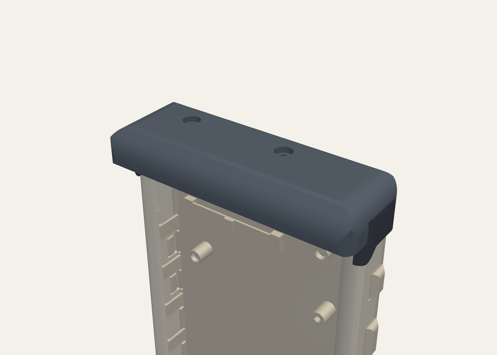
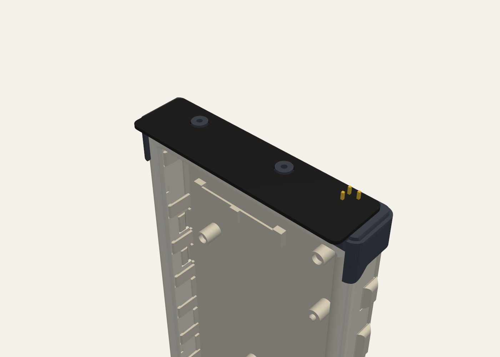
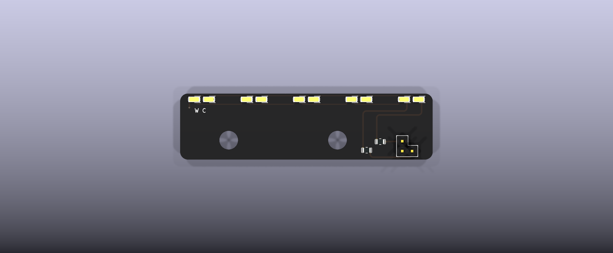

# Silkscreen light attachment

**A clip-on warm/cool reading light for the [Silkscreen](https://github.com/iandchasse/silkscreen-pcb) e-reader.** It is a small cap that pushes onto the top of the stock case. Three header pins go down through the opening the case already has in its top wall and plug into the main board's second light header, `J6`. The case is not modified.

- A 1.0 mm board carries 5 warm (3000 K) and 5 cool (6000 K) LEDs and two 200 Ω resistors. JLCPCB assembles those 12 parts, and can also fit the two short through-hole pin headers; or you solder the headers yourself (3 joints).
- Two printed parts (base + lid) and two M2 screws hold the board. No glue, no optics parts, nothing to modify.
- The reader's normal frontlight controls (brightness and warmth) drive it. It is meant for a reader with nothing on the frontlight connector `J3`.

> **Status (2026-10-21): the rev B board and the rev B housing are built and work.** Pins line up with `J6`, the cap fits the 4.26" case and snaps on, and the light works. **The rev C housing (enclosing hood, rounder brow, rabbeted seam) is checked in CAD only and has not been printed yet.** The board is unchanged (rev B). The rev B prints are in `archive/rev-B-housing/print/`.
>
> Cheapest first step: print the two parts (about 36 min, 8.6 g; rev C, with the enclosing hood) and try the empty base on your case. It has no metal, so that is safe.

| On the stock case (render) | Exploded | Light board, LED side (faces the case) |
|:---:|:---:|:---:|
|  |  |  |

More renders: [front](housing/out/render/front.png), [right side](housing/out/render/side_right.png), [section through `J6`](housing/out/render/section_J6_x54.66.png), [section through an LED](housing/out/render/section_led_x28.1.png), [section through a screw boss](housing/out/render/section_boss_x10.png), [board top side](pcb/docs/images/render_bottom.png).

## What you need

LCSC stock on 2026-09-25 is in parentheses. All five parts are JLC Extended parts.

| Item | Qty | Notes |
|---|---|---|
| Light PCBA | 1 | 2 layers, 1.0 mm, 65.0 × 17.0 mm. Everything sits on one side. The JLC files hold all 14 parts: the 12 SMD parts plus the 2 headers (through-hole; untick them at JLC to solder them yourself): warm LED C210340 × 5 (102,969), cool LED C210343 × 5 (40,519), 200 Ω Vishay CRCW0805200RFKEAHP C5972814 × 2 (2,477). See [ORDERING](docs/ORDERING.md) |
| Pin header `J1`, 1 × 2 | 1 | Hong Cheng HC-PZ254-11.5L-1x2PZ, LCSC [C27985187](https://www.lcsc.com/product-detail/pin-headers_hong-cheng-hc-pz254-11-5l-1x2pz_C27985187.html) (24,852). Fitted by JLC or by you |
| Pin header `J2`, 1 × 1 | 1 | Hong Cheng HC-PZ254-11.5L-1x1PZ, LCSC [C27985186](https://www.lcsc.com/product-detail/pin-headers_hong-cheng-hc-pz254-11-5l-1x1pz_C27985186.html) (10,775). Fitted by JLC or by you |
| Printed base and lid | 1 each | PETG (PLA for a trial), no supports. Base 20 min 20 s, 3.25 g; lid 15 min 50 s, 5.32 g (Elegoo CC2, 0.4 nozzle, 0.20 mm). **Print the lid in a light colour (white, light grey, silver silk):** the hood is a reflector, and a black lid absorbs the light it would add. Optional: turn on **Detect thin wall** so the 0.2 mm stop under each screw hole prints |
| Screws, M2 × 3 pan head | 2 | ISO 7045 (cross) or ISO 14583 (Torx), machine or thread-forming. **Not longer than 3 mm** |

Tools: a soldering iron, a spare 2.54 mm 2-row female header (a jig to hold the pins square), a small screwdriver and a multimeter. A current-limited bench supply is useful for the optional bench test.

## How it goes together

1. Order the boards with assembly, and print the base and lid ([ORDERING](docs/ORDERING.md)).
2. If JLC did not fit them, solder `J1` and `J2` straight, using the female header as a jig. The pin tails stay full length: the lid has a pocket for them.
3. Drop the board into the base, put the lid on and drive the 2 screws until snug.
4. Turn the frontlight **off**, push the cap straight down onto the top of the reader, and take it off by its ends.

Full steps: [ASSEMBLY](docs/ASSEMBLY.md).

## Safety in short

- **Frontlight off (brightness 0) before you plug it in or pull it off.** If the light was on with nothing attached, wait about 10 s.
- **Only `J6` pins 5, 6 and 11 are used.** Every other `J6` position has no pin, pad or copper on the board, so the ground pin (4) and the raw battery pin (12) are never touched.
- **The cap keys the plug.** The case opening is off-centre, and the cap's walls line the pins up before they reach `J6`. Turned round, the pins land on the solid top of the case.
- **Never plug the bare board into `J6`.** Rev B has no reverse-protection diodes. The main board is safe either way, but a wrongly placed bare board can put a reverse voltage across the LEDs and damage them.
- **TPS923611 main boards** have a smaller hot-plug margin, so the light-off rule matters most there.

Details and the bench test: [SAFETY-AND-TEST](docs/SAFETY-AND-TEST.md).

## What the light is like

Bright near the top of the page and fading down it: 10 mm down the page gets about 12 × the light of the page middle, the bottom edge about 1/5 of it. Fine as a reading light, not an even frontlight. The front hood hides the LEDs and the board edge from your eyes and, on a light-coloured lid, bounces a little more light down the page (about +12 % in the lower half, +14 % mid-page, +24 % at the top; none on a black lid). Shaping the light further is a job for printed changes to the cap. Numbers: [DESIGN](docs/DESIGN.md#optics-functional-enough).

## Docs

| Doc | What it covers |
|---|---|
| [docs/ORDERING.md](docs/ORDERING.md) | JLCPCB PCB and assembly fields, the placement-preview check, headers, screws, printing |
| [docs/ASSEMBLY.md](docs/ASSEMBLY.md) | Soldering the headers, putting the cap together, fitting it on the reader |
| [docs/SAFETY-AND-TEST.md](docs/SAFETY-AND-TEST.md) | The rules, a bench test of the bare board, what the reader should show |
| [docs/DESIGN.md](docs/DESIGN.md) | Why it is built this way, electrical and optics numbers, known limits |
| [docs/FIRMWARE-NOTES.md](docs/FIRMWARE-NOTES.md) | Recommended firmware changes (enable pulse, load check). The firmware is not changed |
| [pcb/docs/jlc-notes.md](pcb/docs/jlc-notes.md) | Generated JLC order notes |
| [pcb/docs/design_summary.md](pcb/docs/design_summary.md) | Generated electrical and placement summary |
| [housing/out/REPORT.md](housing/out/REPORT.md) | Generated housing check report |
| [design/DESIGN-SPEC-revB.md](design/DESIGN-SPEC-revB.md) | The rev B contract |

## Folder map

| Path | What it is |
|---|---|
| `pcb/` | Generated KiCad 9 project. `pcb/tools/` generates everything; do not edit the `.kicad_*` files by hand |
| `pcb/production/` | Gerber zip, `bom.csv`, `jlc_bom.csv`, `jlc_cpl.csv`, STEP/STL (including the PCBA in the case frame) |
| `pcb/docs/` | Schematic and layout PDFs, renders, `design_summary.md`, `jlc-notes.md`, gate reports, part evidence |
| `housing/src/` | CadQuery source for the base and lid, and the fit checks |
| `housing/out/` | Print files (`print/base.stl`, `lid.stl`, `.step`, `plate.3mf`), `REPORT.md`, `checks.json`, renders, slicer report |
| `design/` | The rev B contract (`DESIGN-SPEC-revB.md`), the stock-case mechanical spec, and the rev A design notes and reviews |
| `research/` | Source research: `J6` electrical and mechanical, the stock case |
| `tools/` | Optics ray-trace scripts (`optics_sim.py` is the one rev B uses; the rev A rod-lens scripts are in `archive/rev-A-rod-lens/tools/`) |
| `workflows/` | **Local only, not tracked**: the scripts that drove the design runs |
| `archive/rev-A-rod-lens/` | Rev A (rod lens, carrier, clip and cover): its PCB, housing and docs. Not current |
| `archive/rev-B-housing/print/` | The rev B printed parts (the ones first printed: short visor, open ends, flat seam). Superseded by the rev C housing in `housing/out/print/` |
| `enclosures/silkscreen-enclosure-claude/` | **Local only, not tracked**: the old rev K case copy. The checks now read the consolidated 4.26" case instead (see Housing below) |

## Regenerating

**PCB.** Close KiCad first: the scripts refuse to write while a `*.lck` file exists.

```
cd pcb
"C:\Program Files\KiCad\9.0\bin\python.exe" tools\generate.py
"C:\Program Files\KiCad\9.0\bin\python.exe" tools\make_outputs.py
```

`make_outputs.py` runs every gate first and writes `production/`, `docs/` and `build/geometry.json` only if all pass.

**Housing.** Use a Python 3.11 venv made from silkscreen-enclosures' `enclosures/case-426/requirements.txt` (CadQuery, trimesh, manifold3d). Run the PCB step first: the housing reads `pcb/build/geometry.json` and the case it fits: the **4.26" standard (strip-less) case**, whose tub.stl + lid.stl are copied into `housing/reference/case-426-standard/` (from silkscreen-enclosures, `enclosures/case-426/out/standard/`; see `PROVENANCE.md` there). Set `SILKSCREEN_CASE_OUT` to check against another build, e.g. a fresh one in `../silkscreen-enclosures/enclosures/case-426/out/standard/`. The 3.68" case has no `J6` and is not supported.

```
cd housing
python src\build.py       # --no-render for a quicker run
```

`build.py` builds both parts, runs the checks, writes `out/` and exits with code 1 on any failed check. Optional: `python src\optics_report.py` (system Python) refreshes `out/optics.json`, and `src\slice_check.py` (same venv, needs OrcaSlicer) refreshes the slice report; run `build.py` again afterwards to fold both into `REPORT.md`.

## Credits and licence

Designed by Ian Chasse (idc LLC) as a companion to [silkscreen-pcb](https://github.com/iandchasse/silkscreen-pcb). The generator structure comes from the sibling project [silkscreen-light-strip](https://github.com/iandchasse/silkscreen-light-strip). The stock case is the 4.26" case of [silkscreen-enclosures](https://github.com/iandchasse/silkscreen-enclosures) (its top is unchanged since rev K).

CERN-OHL-S-2.0, © 2026 idc LLC. See [LICENSE](LICENSE) and [NOTICE](NOTICE). The KiCad library parts in `pcb/lib/` keep their own terms (listed in NOTICE). The third-party evidence behind the part choices (a datasheet page, LCSC/EasyEDA part data) is kept locally in `pcb/docs/sources/` and is not published.
